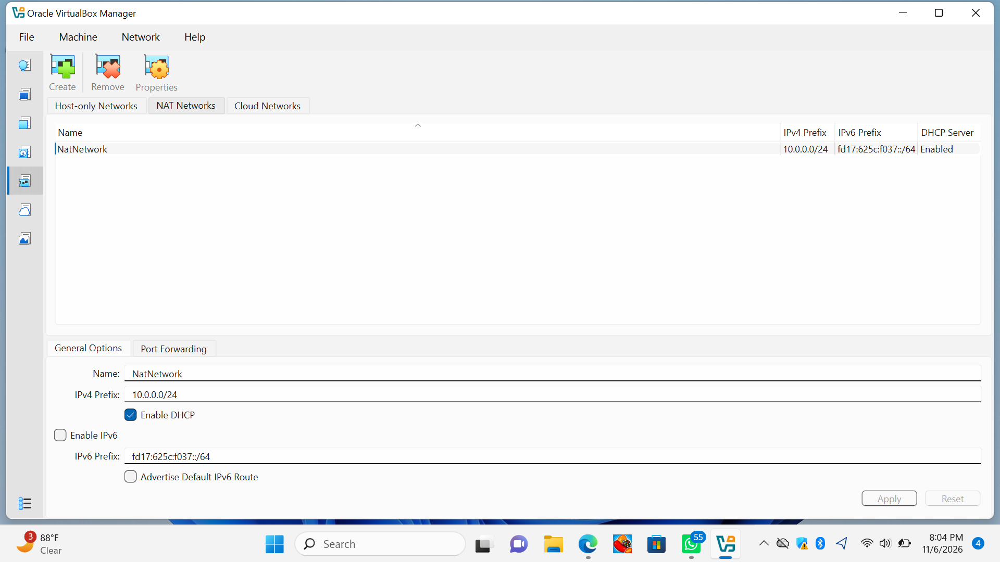
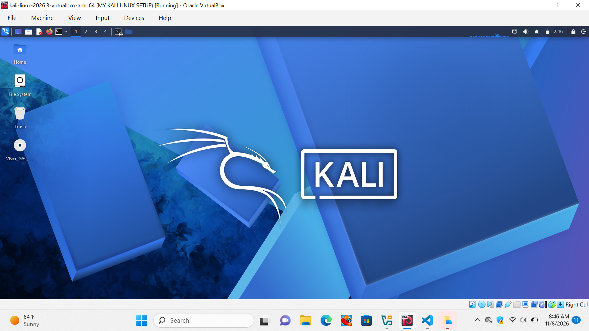

# NETWORKWALKS-KARIMA-YAHYA-AHMAD-B084-WK1-PM1-CYBERSECURITY-LAB-SETUP
Week 1: Cybersecurity Lab Setup

Introduction

This project documents my Week 1 task in the Networkwalks Cybersecurity Program. The task involved setting up a cybersecurity lab environment using VirtualBox and Kali Linux.

Objectives

- Install and configure VirtualBox.
- Set up a Kali Linux virtual machine.
- Configure the NAT Network.
- Check the Kali Linux network configuration.

Tools Used

- Oracle VirtualBox
- Kali Linux
- Windows 11

Lab Configuration

- Virtualization software: Oracle VirtualBox
- Operating system: Kali Linux
- Network mode: NAT Network
- Network subnet: 10.0.0.0/24
- Kali Linux IP address: 10.0.0.2/24

Implementation

I installed and configured VirtualBox, set up the NAT Network, and started the Kali Linux virtual machine.

Challenges and Solutions

During the setup, I experienced difficulties with the network connection and transferring screenshots from Kali Linux to Windows. These challenges helped me understand the importance of troubleshooting when configuring a virtual lab environment.

Conclusion

This task gave me practical experience with virtual machines, network configuration, and setting up a cybersecurity lab environment.

## Screenshots

### 1. VirtualBox Manager

### 2. NAT Network

### 3. Kali Linux Desktop

### 4. Kali Linux IP Address

